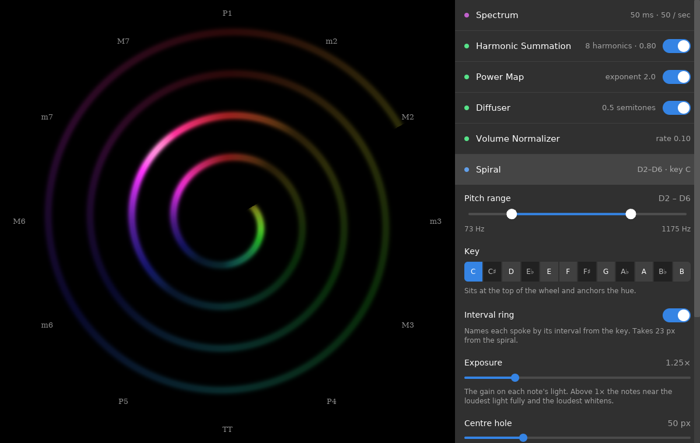

# Melody Visualizer

A real-time music visualizer for Linux that draws the pitches it hears on a
spiral, one turn per octave. It runs as a CLAP plugin in a DAW, and as a
standalone JACK app built from the same code.



## Why a spiral

A spectrum analyser draws frequency on a straight line, so the same note in two
octaves lands in two unrelated places, and the overtones of one note look like
more notes. Musicians do not hear pitch that way: a C is a C in every octave.

On the spiral, every turn is an octave, so all the Cs sit on one spoke. The
key you choose sits at the top, and a note's hue shows its interval from the
key. A melody moves round the wheel, and a chord lights a shape. Before
drawing, the visualizer scores each frequency by its whole harmonic series,
which lets the fundamental of a note stand out over its overtones.

The pane at the right of the window shows the pipeline, one stage per row: the
spectrum analysis, each transform, and the spiral. Click a row to open its
controls. Every control is a plugin parameter, so the host saves them with the
project and can automate them.

## Platform support

Linux only, and tested only on Debian-based systems (Debian and Ubuntu). The
plugin is developed against Bitwig Studio; other CLAP hosts should work.

The window is drawn with [iced](https://iced.rs/) through
[baseview](https://github.com/RustAudio/baseview), which supports only X11 on
Linux, so the host has to run under X11 or XWayland. It renders on the GPU
through wgpu, which needs Vulkan or OpenGL drivers.

## Building

You need a stable Rust toolchain that supports edition 2024, for example from
[rustup](https://rustup.rs/), and the ALSA development headers for the
standalone build's ALSA backend. The standalone loads JACK at run time, so it
needs no JACK headers to build:

```bash
sudo apt install build-essential pkg-config libasound2-dev
```

Optional: the [Playfair Display](https://fonts.google.com/specimen/Playfair+Display)
font, which the interval ring's labels are set in. Put the font files in
`~/.local/share/fonts` and run `fc-cache`. Without it, the labels use the
default face.

## Installing the plugin

Bundle the CLAP plugin and link it where hosts look for plugins:

```bash
cargo xtask bundle melody-visualizer --release
mkdir -p ~/.clap
ln -sf "$PWD/target/bundled/Melody Visualizer.clap" ~/.clap/
```

Each `cargo xtask bundle` overwrites the bundle in place, so the link keeps
pointing at the latest build; the host only has to rescan or reload it.

In Bitwig, put **Melody Visualizer** on any track or bus as an audio effect.
It passes its audio through untouched and analyzes a mono mix of it. Open the
plugin's window to see the spiral. The spiral moves only while the host is
processing audio through the plugin.

Set `NICE_LOG=/path/to/file` in the host's environment to capture the plugin's
log.

## Running standalone

The standalone app does not start a JACK server itself. Start it under a
running server and connect its input with `--connect-jack-inputs` or any
patchbay. On a PipeWire desktop, run it through `pw-jack`:

```bash
pw-jack cargo run --release -- --connect-jack-inputs <port>
cargo run --release -- --help    # every option
```

The standalone does not save its settings: each run starts from the defaults.

## Development

[DEVELOPMENT.md](DEVELOPMENT.md) covers the tests, benchmarks, style guide,
and how to screenshot the window with no display or audio hardware.
[ARCHITECTURE.md](ARCHITECTURE.md) describes the components and threads.
